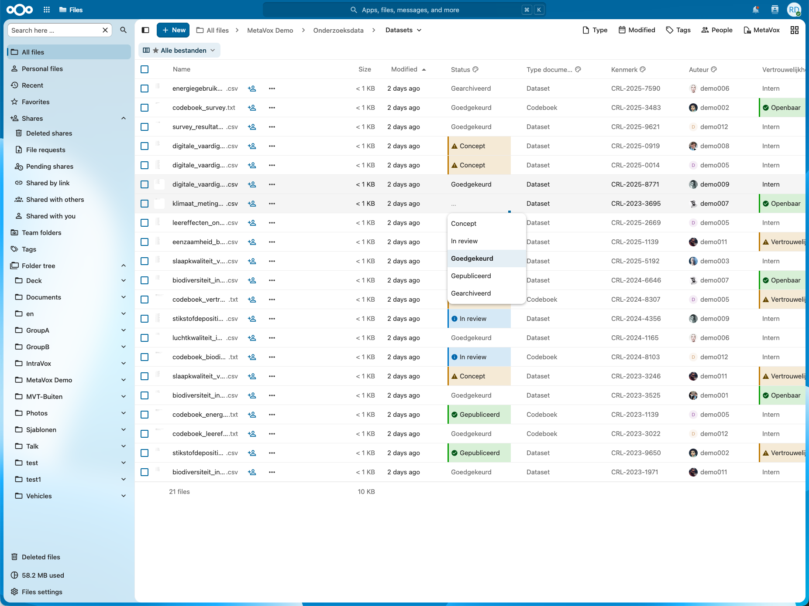
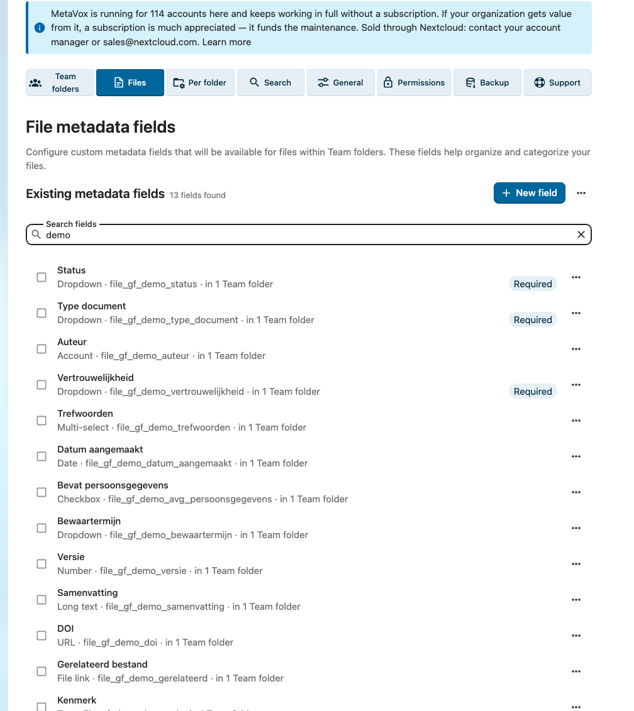

# MetaVox – Metadata for Nextcloud Team folders

MetaVox brings structured metadata to Nextcloud Team folders. Define the fields your team needs, fill them in right in the file list, and filter, sort, highlight and search on them, even in folders with hundreds of thousands of files. Your files stay untouched: the metadata is stored separately.

MetaVox ("vox" is Latin for voice: metadata as the voice of the document) is open source. It started at the University of Amsterdam and the Amsterdam University of Applied Sciences, and is used by universities, government organizations and enterprises.

## Features

### Work in the file list

- **Metadata columns.** Your fields appear as columns in Files. Double-click a cell to edit it, or edit many files at once.
- **Ten field types.** Text, long text, number, date and time, checkbox, dropdown, multi-select, URL, account and file link.
- **Values you can trust.** Required fields stay filled, and every value is checked, however it arrives.

### See what matters

- **Views.** Save columns, filters and sorting per Team folder, and switch between them in one click.
- **Highlights.** Color cells by their value: overdue in red, due soon in orange, approved in green.
- **Instant filter and sort.** Search a filter's values and narrow down thousands of files at once.

### Find it again

- **Search by field.** Filter Nextcloud's search bar on a field value, in one Team folder or all of them.
- **Saved searches as folders.** Keep a search as a folder in Files, always up to date. Nextcloud 33 and newer; an administrator turns it on.

### Work together

- **Live updates.** Changes appear for everyone at once, and a cell someone is editing is locked.
- **Nextcloud's permissions.** You see and change the metadata of exactly the files you can, ACL included.

### Automate and connect

- **Default values.** New files get their Team folder's defaults.
- **AI suggestions.** Let AI read a file and suggest its metadata, through the AI provider your Nextcloud uses.
- **Flow.** Act on metadata: notifications, access control, retention.
- **WebDAV and REST API.** Ask for `<nc:metavox/>` in a PROPFIND to get every file's metadata with the folder listing, or use the OCS API.
- **Backup and restore.** Daily backups, restored with one click.

## Who does what

MetaVox follows Nextcloud's own permissions, and adds one right of its own.

| Action | Who |
|--------|-----|
| See the metadata of a file | Anyone who can open the file in its Team folder |
| Change the metadata of a file | Anyone who may change the file in its Team folder |
| Create and change views, change the Team folder's own metadata | Members who may change the Team folder |
| Assign fields to a Team folder, set default values | Members with the MetaVox manage permission who may change the Team folder |
| Create, change and delete field definitions; app settings | Nextcloud administrators |

An administrator gives the manage permission to groups on the MetaVox admin page. See [Permissions](docs/admin/permissions.md).

## Requirements

- Nextcloud 31 to 35
- PHP 8.1 or newer
- The Team folders app (`groupfolders`)
- MySQL, MariaDB or PostgreSQL. SQLite is for trying MetaVox out.

Recommended: system cron, Redis, and the Client Push app (`notify_push`) for live updates. See [Installation](docs/admin/installation.md).

MetaVox is available in English, Dutch, French, German and Swedish.

## Installation

Install MetaVox from the Nextcloud App Store: Apps → Files, or search for "MetaVox". Then open Administration settings → MetaVox to create your first fields. See the [Getting Started guide](docs/getting-started.md).

## Documentation

The full documentation starts at [docs/index.md](docs/index.md):

- [For users](docs/user/overview.md): working with metadata, views, highlights, search, bulk editing
- [For administrators](docs/admin/installation.md): installation, permissions, settings, backup and restore, compliance templates
- [For architects](docs/architecture/overview.md): architecture, privacy and security, API reference, performance

## Support

- **Issues and feature requests:** [GitHub Issues](https://github.com/nextcloud/metavox/issues)
- **Questions and ideas:** [GitHub Discussions](https://github.com/nextcloud/metavox/discussions)
- **Subscriptions and support:** [voxcloud.nl](https://voxcloud.nl), see [Support & Subscriptions](docs/admin/licensing.md)

## Authors

Sam Ditmeijer and Rik Dekker. See [AUTHORS.md](AUTHORS.md).

## License

MetaVox is licensed under the [GNU Affero General Public License v3.0 or later](LICENSE).
