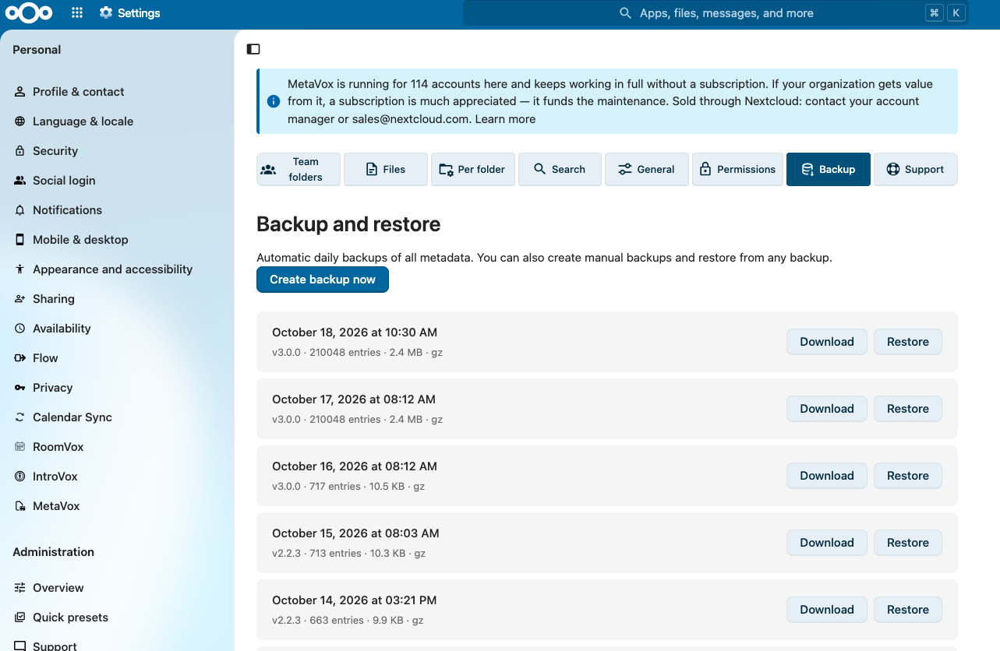

# Backup & Restore

MetaVox backs up its fields and metadata values every day. You can also create a backup yourself, download one, and restore one. Only Nextcloud administrators can do this.



## What a backup holds

A backup holds three tables:

| Table | What it holds |
|-------|---------------|
| `metavox_gf_fields` | Field definitions, for Team folders and for files |
| `metavox_gf_metadata` | The metadata of Team folders themselves |
| `metavox_file_gf_meta` | The metadata of files |

A backup does **not** hold:

- Views and their highlight rules (`metavox_gf_views`)
- Which fields each Team folder uses, and their default values (`metavox_gf_assigns`)
- The MetaVox manage permission (`metavox_permissions`)
- The search index (`metavox_search_words`). A restore rebuilds it from the restored values.
- Users' saved searches (Nextcloud user preferences)
- Admin settings and the subscription key (Nextcloud app config)

To keep those too, back up the Nextcloud database.

## Where backups are stored

Backups are gzip-compressed JSON files in Nextcloud's app data: `<datadirectory>/appdata_<instanceid>/metavox/backups/`.

- A daily backup is named `metavox_backup_<date>.json.gz`, for example `metavox_backup_2026-10-18.json.gz`.
- A backup you create is named `metavox_backup_<date>_<time>.json.gz`, for example `metavox_backup_2026-10-18_14-30-05.json.gz`.

MetaVox keeps at most 7 backups. Daily and manual backups count together: after each new backup, the oldest go until 7 are left.

## Daily backups

A background job (`MetadataBackupJob`) creates a backup once every 24 hours. It runs with Nextcloud's background jobs, so use system cron: with AJAX or Webcron it only runs when someone has a page open.

## Create a backup

1. Go to **Administration settings** → **MetaVox**.
2. Open the **Backup** pane. It shows the section **Backup and restore**.
3. Click **Create backup now**.

A progress bar shows how far the backup is, and in which table. When it is done, MetaVox says **Backup completed**, with the time it took and the file size. The new backup appears at the top of the list.

## Restore a backup

> **Warning**: A restore replaces all field definitions and metadata values with those in the backup. This cannot be undone. Create a backup first if you may want to go back.

1. Open the **Backup** pane.
2. Find the backup in the list. Each row shows the date, the MetaVox version that made it, the number of entries and the size.
3. Click **Restore** on that row.
4. The dialog **Restore backup** shows the date of the backup and how many field definitions, Team folder values and file values it holds. Click **Restore** to go ahead, or **Cancel**.

A progress bar shows the restore. When it is done, MetaVox says **Restore completed**.

After the restore, MetaVox rebuilds the search index and drops its cached values, so the restored metadata shows the next time a page loads. File links from a backup of an older version still hold file paths; MetaVox removes those, and the links keep working by file ID.

## One at a time

While a backup or restore runs, **Create backup now** and **Restore** are disabled. Starting another one anyway, for example through the API, is refused with 409 and the message "A backup or restore is already running". The daily backup does not check this.

## Download a backup

Click **Download** on a row to save the backup file, for example to store it off the server.

## Via the API

These are browser routes for the admin page, not part of the stable OCS API (see [API Reference](../architecture/api-reference.md)). From a script, use an app password of an administrator and send the header `OCS-APIRequest: true`. With that header Nextcloud accepts the request without a CSRF token.

```bash
# List the backups
curl "https://your-nextcloud.com/index.php/apps/metavox/api/backup/list" \
  -u "admin:app-password" \
  -H "OCS-APIRequest: true"

# Create a backup; answers when it is done
curl -X POST "https://your-nextcloud.com/index.php/apps/metavox/api/backup/trigger" \
  -u "admin:app-password" \
  -H "OCS-APIRequest: true"

# Download a backup
curl "https://your-nextcloud.com/index.php/apps/metavox/api/backup/download?filename=metavox_backup_2026-10-18.json.gz" \
  -u "admin:app-password" \
  -H "OCS-APIRequest: true" \
  -o metavox_backup_2026-10-18.json.gz

# Restore a backup; answers when it is done
curl -X POST "https://your-nextcloud.com/index.php/apps/metavox/api/backup/restore" \
  -u "admin:app-password" \
  -H "OCS-APIRequest: true" \
  -H "Content-Type: application/json" \
  -d '{"filename": "metavox_backup_2026-10-18.json.gz"}'
```

`list` answers with `backups`: per backup its `filename`, `created_at`, `version`, `size` in bytes, `counts` per table, and `compressed`.

### Status

The admin page asks for the status every 2 seconds while a backup or restore runs:

```bash
curl "https://your-nextcloud.com/index.php/apps/metavox/api/backup/status" \
  -u "admin:app-password" \
  -H "OCS-APIRequest: true"
```

While nothing runs, or an hour after the last one finished:

```json
{"status": "idle"}
```

While a restore runs (`operation` is `export` for a backup, `import` for a restore):

```json
{
  "status": "running",
  "operation": "import",
  "progress": 5000,
  "total": 11000,
  "table": "metavox_file_gf_meta",
  "started_at": "2026-10-18T14:30:05+02:00"
}
```

`progress` and `total` count rows. When it is done, `status` is `completed`, with `filename`, `progress`, `total` and `duration` in seconds; a backup adds `size`, a restore adds `restored` (rows per table). When it fails, `status` is `error`, with `error` and `reason`.

## Performance

- A backup reads each table in chunks of 5,000 rows, so memory use stays low with millions of values.
- A restore writes 1,000 rows at a time and commits every 10,000 rows.
- A restore reads both `.json.gz` and uncompressed `.json` files.

## See Also

- [Settings](settings.md) - The panes of the admin page
- [Privacy & Security](../architecture/privacy.md) - What MetaVox stores
- [API Reference](../architecture/api-reference.md) - Full API documentation
