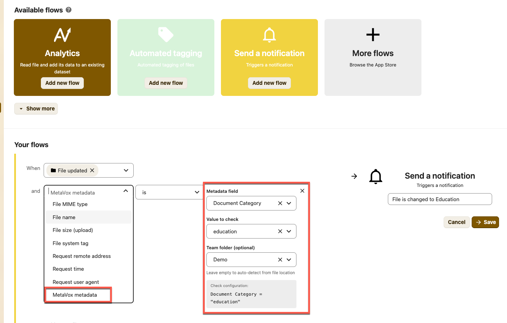
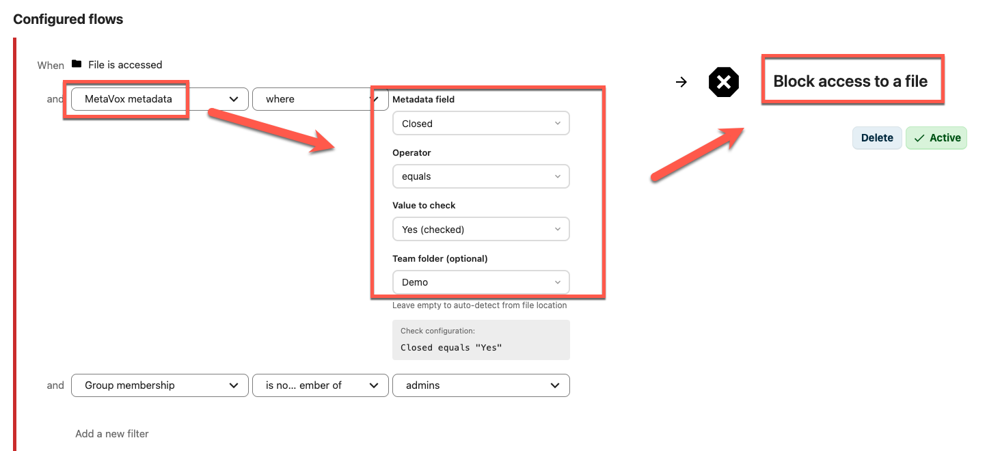

# MetaVox Flow-integratie

MetaVox integreert met Nextcloud's **Flow** (Workflow Engine) voor metadata-gebaseerde automatisering en toegangscontrole.

## Overzicht

Met Flow-integratie kun je regels maken zoals:

- Toegang blokkeren tot documenten gemarkeerd als vertrouwelijk
- Bestanden automatisch taggen op basis van hun metadata

De MetaVox-controle is alleen beschikbaar in de **beheer**-instellingen van Flow. Persoonlijke Flow-regels (**Instellingen → Persoonlijk → Flow**) kunnen hem niet gebruiken: een persoonlijke regel zou waarden kunnen testen van bestanden die de gebruiker alleen via een share bereikt. De server weigert een regel met de MetaVox-controle van iedereen die geen Nextcloud-beheerder is (ook gedelegeerde Flow-beheerders), ook als die rechtstreeks via de Flow-API wordt ingestuurd.

## Vereisten

1. MetaVox geïnstalleerd en geconfigureerd
2. Voor toegangscontrole: installeer de **Files Access Control**-app uit de Nextcloud App Store

## Flow-regels opzetten

### Een regel aanmaken

1. Ga naar **Instellingen → Beheer → Flow**
2. Klik **Nieuw flow toevoegen**
3. Selecteer een trigger (bv. "Bestand geopend", "Bestand aangemaakt")
4. Klik onder **Voorwaarden** op **Voorwaarde toevoegen**
5. Selecteer **"MetaVox metadata"** uit de dropdown
6. Configureer je voorwaarde:
   - **Metadataveld**: selecteer het metadataveld om te controleren
   - **Operator**: kies uit de operators voor dat veldtype
   - **Te controleren waarde**: voer de waarde in om mee te vergelijken (verborgen bij **is empty**, **is not empty**, **is checked** en **is not checked**)
   - **Teammap (optioneel)**: **Automatisch bepalen** (standaard) of één specifieke teammap

### Op welke bestanden een regel werkt

- **Alleen bestanden in een teammap.** De controle zoekt de teammap op waarin het bestand staat. Bestanden buiten een teammap matchen nooit, net als bestanden in de prullenbak of de versies van een teammap.
- **Bestanden, geen mappen.** De controle matcht nooit een map.
- **Teammap (optioneel)**: met **Automatisch bepalen** werkt de regel in elke teammap. Kies je een teammap, dan werkt de regel alleen op bestanden in die teammap; bestanden in andere teammappen matchen nooit.
- **De eigen waarden van het bestand.** De controle vergelijkt de waarde die op het bestand is opgeslagen. De veldlijst toont ook **Teammap-metadatavelden**, maar hun waarde hoort bij de teammap, niet bij het bestand, dus de controle ziet ze als leeg.

### Beschikbare operators

De lijst met operators hangt af van het veldtype. Het formulier biedt (de operatornamen staan in de interface in het Engels):

| Veldtype | Operators |
|----------|-----------|
| Tekst, Lange tekst | equals, is not, contains, does not contain, is empty, is not empty |
| Nummer | equals, is not, greater than, less than, greater or equal, less or equal, is empty, is not empty |
| Datum | is before, is after, equals, is empty, is not empty |
| Dropdown | equals, is not, is one of, is empty, is not empty |
| Meerkeuze | is one of, contains all, is empty, is not empty |
| Selectievakje | is checked, is not checked |
| URL | equals, is not, contains, does not contain, is empty, is not empty |
| Gebruiker | equals, is not, is empty, is not empty |
| Bestandslink | is empty, is not empty |

Zo vergelijken ze:

| Operator | Beschrijving |
|----------|--------------|
| equals / is not | Exacte match (of niet), niet hoofdlettergevoelig |
| contains / does not contain | Waarde bevat de tekst (of niet), niet hoofdlettergevoelig |
| is empty / is not empty | Veld heeft geen waarde / heeft een waarde |
| is before / is after | Datum ligt voor / na de gegeven waarde; beide worden als tijdstip vergeleken |
| greater than, less than, greater or equal, less or equal | Numerieke vergelijking; een waarde die geen getal is, matcht nooit |
| is one of | Dropdown: de waarde is één van de gekozen opties. Meerkeuze: het bestand heeft er minstens één van |
| contains all | Meerkeuze: het bestand heeft alle gekozen opties |
| is checked / is not checked | Selectievakje; een vakje dat nooit is gezet telt als niet aangevinkt |

Een meerkeuzeveld wordt per optie vergeleken, niet als tekst: "is one of IT" matcht geen bestand dat alleen "IT-beheer" heeft.

Bij datumvelden schakelt de waardekiezer automatisch: velden met alleen een datum gebruiken een `date`-input, velden met **Tijd meenemen** ingeschakeld een `datetime-local`-input.

Eerder gemaakte regels blijven werken en houden hun operator in het formulier: een vinkjesregel met **equals** "Ja (aangevinkt)" of "Nee (niet aangevinkt)", of een meerkeuzeregel met **contains**, die nu als **is one of** wordt getoond. Voorheen matchte een meerkeuzeregel met **contains** of **contains all** geen bestanden met meer dan één optie; nu wel.

De server accepteert ook de operators `matches` en `!matches` (reguliere expressie) voor regels die via de Flow-API worden aangemaakt.

### Veld-specifieke input

De waarde-input past zich aan het veldtype aan:

- **Dropdown-velden**: de geconfigureerde opties; bij **is one of** meerdere tegelijk
- **Meerkeuzevelden**: de geconfigureerde opties, meerdere tegelijk
- **Selectievakjes**: geen waarde; de operator zegt het
- **Datumvelden**: datumkiezer (met tijd als het veld tijd meeneemt)
- **Nummervelden**: numerieke input
- **Overige velden**: vrije tekst-input

## Voorbeeld use-cases

### Toegang blokkeren tot vertrouwelijke bestanden

1. Maak een Flow-regel met trigger "Bestand geopend"
2. Voeg voorwaarde toe: MetaVox metadata > `classification` **equals** `confidential`
3. Voeg actie toe: **Blokkeer toegang**

Resultaat: gebruikers kunnen geen bestanden openen die als vertrouwelijk zijn gemarkeerd, tenzij de voorwaarde wordt gewijzigd.

### Toegang blokkeren tot niet-gereviewde documenten

1. Maak een Flow-regel met trigger "Bestand geopend"
2. Voeg voorwaarde toe: MetaVox metadata > `review_status` **is one of** `draft`, `in review`
3. Voeg actie toe: **Blokkeer toegang**

Resultaat: documenten die niet gereviewd zijn, kunnen niet worden geopend of gedownload. Bestanden zonder reviewstatus blokkeert deze regel niet; voeg een tweede regel met **is empty** toe als dat wel moet.

### Auto-tagging op basis van metadata

1. Maak een Flow-regel met trigger "Bestand aangemaakt"
2. Voeg voorwaarde toe: MetaVox metadata > `department` **equals** `Legal`
3. Voeg actie toe: **Tag toevoegen** "legal-team"

Resultaat: bestanden aangemaakt in de Legal-afdeling worden automatisch getagd.

## Tips

- **Veldgroepen**: de veldlijst heeft twee groepen: "Bestandsmetadatavelden" en "Teammap-metadatavelden"
- **Testen**: test regels eerst met niet-kritieke bestanden
- **Logging**: check de Nextcloud-logs als regels niet triggeren zoals verwacht; een mislukte controle wordt gelogd als "MetaVox Flow check failed"

## Admin- vs persoonlijke Flow

| Actie | Waar configureren | Scope | MetaVox-controle |
|-------|-------------------|-------|------------------|
| **Toegang tot een bestand blokkeren** | Instellingen → Beheer → Flow | Geldt voor alle gebruikers | Beschikbaar |
| **Notificatie versturen** | Instellingen → Persoonlijk → Flow | Geldt alleen voor jou | Niet beschikbaar |

Notificatie-flows zijn in Nextcloud persoonlijk, dus ze kunnen MetaVox-metadata niet als voorwaarde gebruiken.

## Beperkingen

- Flow-regels evalueren wanneer triggers vuren (bestand geopend, aangemaakt, etc.)
- Metadata-wijzigingen alleen triggeren mogelijk geen regels tenzij gecombineerd met bestands-events
- Complexe voorwaarden vereisen mogelijk meerdere regels

## Zie ook

- [Compliance-templates](compliance-templates.md) — Voorgebouwde metadata-schema's met Flow-voorbeelden
- [Permissies](permissions.md) — Basis-toegangscontrole
- [Architectuur-overzicht](../architecture/overview.md) — Hoe Flow-integratie technisch werkt
