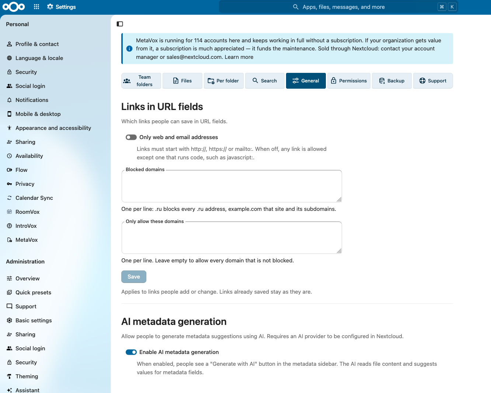

# Beheerder-instellingen

MetaVox-beheer-instellingen vind je via **Instellingen → Beheer → MetaVox**.



## Onderdelen

De pagina toont steeds één onderdeel. Kies het in de rij bovenaan:

| Onderdeel | Wat erin staat |
|-----------|----------------|
| **Teammappen** | Velden voor Team folders zelf |
| **Bestanden** | Velden voor bestanden en mappen in Team folders |
| **Per map** | Per Team folder: toegekende velden, standaardwaarden en de eigen metadata van de Team folder |
| **Zoeken** | Het metadatafilter in de zoekbalk, en filters als map bewaren in Bestanden; zie [Metadata doorzoeken](#metadata-doorzoeken) |
| **Algemeen** | Welke links URL-velden nemen, en AI-metadatageneratie; zie [Links in URL-velden](#links-in-url-velden) |
| **Rechten** | Het MetaVox-beheerrecht, zie [Permissies](permissions.md) |
| **Back-up** | Back-up en herstel, zie [Back-up & herstel](backup-restore.md) |
| **Ondersteuning** | Abonnementssleutel en anonieme gebruiksstatistieken |

De pagina onthoudt het onderdeel dat je het laatst open had.

## Instellingen

### Metadata doorzoeken

Twee schakelaars onder **Zoeken**:

- **Metadatafilter in de zoekbalk** (standaard: aan): gebruikers vinden bestanden op een veld en
  de waarde ervan vanuit de zoekbalk van Nextcloud. Licht: een zoekopdracht leest een index.
- **Een filter bewaren als map in Bestanden** (standaard: uit; Nextcloud 33 en nieuwer):
  gebruikers bewaren een filter als map onder **Metadata-zoekopdrachten** in Bestanden. Zo'n map
  toont de nieuwste 500 bestanden en vraagt meer van de server dan een zoekopdracht; weeg dus af
  of je gebruikers het nodig hebben. Werkt alleen als het filter aan staat.

Een wijziging is te zien zodra een pagina opnieuw laadt. Je keuzes blijven bij een update van de
app staan. Zet je de mappen uit, dan blijven de bewaarde zoekopdrachten van gebruikers bestaan; ze
komen terug als je het weer aanzet.

Zie [Metadata doorzoeken](../user/search.nl.md) voor wat gebruikers zien.

### Links in URL-velden

In het onderdeel **Algemeen** bepaal je welke links mensen in URL-velden kunnen opslaan:

- **Alleen web- en e-mailadressen** (standaard: uit): links moeten beginnen met `http://`,
  `https://` of `mailto:`. Staat het uit, dan mag elke link behalve een die code uitvoert, zoals
  `javascript:`.
- **Geblokkeerde domeinen**: één per regel. `.ru` blokkeert elk `.ru`-adres, `example.com` die site
  en zijn subdomeinen.
- **Alleen deze domeinen toestaan**: één per regel. Leeg: elk domein dat niet geblokkeerd is.

Het domein van een e-mailadres en van een adres zonder `https://` telt ook mee. De regels gelden
voor links die mensen toevoegen of wijzigen; links die al zijn opgeslagen blijven staan. Een lijst
met iets wat geen domein is, wordt niet opgeslagen en zegt onder de lijst waarom.

### AI metadata-generatie

In het onderdeel **Algemeen** zet de schakelaar **AI-metadatageneratie inschakelen** AI-metadata-suggesties aan of uit voor alle gebruikers.

- **Standaard**: ingeschakeld
- **Vereist**: een Nextcloud AI task-processing provider (bv. LLM2-app)

Wanneer ingeschakeld en er een provider beschikbaar is, zien gebruikers een knop **Genereren met AI** in het venster waarin ze de metadata van een bestand of map bewerken. Die genereert suggesties op basis van bestandsinhoud.

Zie [AI-autofill](../features/ai-autofill.md) voor details.

### Anonieme gebruiksstatistieken

In het onderdeel **Ondersteuning**, onder **Anonieme Gebruiksstatistieken**, zet de schakelaar **Anonieme gebruiksstatistieken delen** anonieme gebruiks-rapportage aan of uit.

- **Standaard**: ingeschakeld
- **Privacy**: alleen aantallen, versies en basale serverconfiguratie (geen bestandsnamen, gebruikersnamen of metadata-waarden)

Zie [Telemetrie](telemetry.md) voor details.

## Instellingen-API

### Instellingen ophalen

```bash
curl "https://your-nextcloud.com/apps/metavox/api/settings" \
  -b "session-cookie"
```

**Response**:

```json
{
  "success": true,
  "settings": {
    "ai_enabled": false,
    "search_filter": true,
    "search_folders": false
  }
}
```

### Instellingen opslaan

```bash
curl -X POST "https://your-nextcloud.com/apps/metavox/api/settings" \
  -H "Content-Type: application/json" \
  -b "session-cookie" \
  -d '{"ai_enabled": true}'
```

Stuur alleen de instellingen die je wijzigt, bijvoorbeeld `{"search_filter": true, "search_folders": true}`.
Met `occ`: `occ config:app:set metavox search_filter --value=true --type=boolean`.

## Zie ook

- [Installatie](installation.md) — Initiële setup
- [AI-autofill](../features/ai-autofill.md) — AI-feature-documentatie
- [Telemetrie](telemetry.md) — Gebruiks-rapportage
- [Back-up & herstel](backup-restore.md) — Metadata-back-ups
