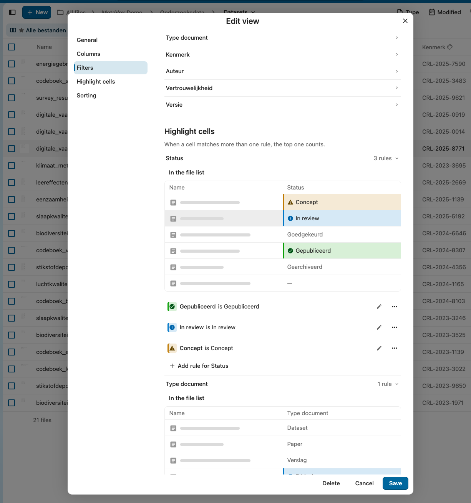

# Managing Views

You create, edit, and delete views per team folder, in the Files app. Views let users quickly switch between predefined combinations of columns, filters, and sort order.

## Who can manage views

Members of the team folder who have write permission on the team folder itself (its top level), and Nextcloud administrators. Everyone else in the team folder can use the views and open them read-only with **View details**.

There is no views page under **Administration → MetaVox**; all view settings are in the Files app.

## Creating a view

1. Open the team folder in the Files app
2. Click the view picker above the file list
3. Click **New view**
4. Enter a name
5. Configure the options (see below)
6. Click **Save**

The view immediately appears in the view menu for everyone in that team folder.

You can also turn filters you set in the file list into a view with **Save filters as view …**. See [Saving filters as a view](../user/views.md#saving-filters-as-a-view).

## Settings

### Name
The name shown in the view picker and menu. Keep it short and descriptive (e.g. "WOO requests", "Pending review", "Public documents"). A name can have at most 100 characters.

### Standard view
Enable **Standard view** to open this view automatically when users open the team folder. Only one view can be the standard view per team folder — setting a new one removes it from the previous one. The standard view is marked with a star (★) in the view menu.

Without a standard view, the team folder opens in **Default**: the plain file list without MetaVox columns.

### Columns

Control which fields appear in the file list and in which order:

| Setting | Meaning |
|---------|---------|
| Visible | The field appears as a column in the file list |
| Filterable | The field appears in the MetaVox filter for this view, and in the **Filters** section of the editor |

Drag the ⠿ handle to reorder rows. The order here determines the left-to-right column order in the file list.

> **Note**: Filterable can only be enabled when the field is Visible. Unchecking Visible automatically disables Filterable.

Changes to the Visible checkbox immediately update which fields are available in the **Filters** and **Sorting** sections of the view editor.

### Filters (preset values)

Set filter values that activate as soon as the view is selected. Only fields that are both **Visible** and **Filterable** appear here.

- **Select / multiselect fields**: check the desired options
- **Yes/No fields**: check "Yes" and/or "No"
- **Text / number / user fields**: type a value and press Enter (or a comma) to add it as a tag; multiple tags work as OR

Date and file link fields have no preset filter.

Users can filter further on top of the preset filters; the view itself does not change.

> **Note**: Values you set before hiding a field stay saved and keep filtering, while the field no longer appears in this section. Users see them as a chip above the file list. Remove the values before you hide the field.

### Highlight cells

Color cells by their value, for example a deadline before today in red. Each visible column can have up to 10 rules; when a cell matches more than one, the top rule counts. See [Highlight Rules](../user/highlight-rules.md) for the conditions, the ready-made rules and how the order works.

### Sorting

Choose the field to sort by and the direction (**Ascending** / **Descending**), or leave it at "— no sorting —". Only fields marked as **Visible** appear in the list. If the field is later removed from the team folder, the sort is removed from the view.

## Editing a view

1. Switch to the view
2. Open the view picker and click **Edit …**
3. Make your changes and click **Save**

Changes take effect for everyone immediately after saving.

## Deleting a view

Open the view editor and click **Delete** (bottom left). Confirm with **Delete view**. This cannot be undone.

If you were in the deleted view, the standard view opens, or **Default** when there is none.

## Tips

- Make a view with only the most relevant columns the standard view, to reduce visual clutter for users
- Use preset filters in combination with visible columns — e.g. a "WOO open" view that shows only the WOO-related fields and filters on status "Open"
- Column order is saved per view — different views can have different column orders
- Views are shared across all users of a team folder; there are no per-user views
- Checkbox fields (Yes/No) always offer both "Yes" and "No" as filter options, even if no documents have been checked yet

## See Also

- [Using Views](../user/views.md) - How users interact with views
- [Highlight Rules](../user/highlight-rules.md) - Color cells by their value
- [Permissions](permissions.md) - Roles and access control
- [Field Types](../user/field-types.md) - Available metadata field types
