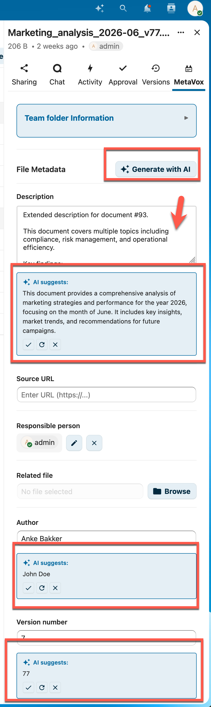

# AI Autofill

MetaVox can automatically suggest metadata values for files using Nextcloud's AI task processing framework.

## Prerequisites

- A Nextcloud AI task processing provider installed (e.g., the LLM2 app or an external provider) that offers text generation
- AI enabled in MetaVox admin settings (enabled by default)
- For text from PDF, DOCX and ODT files: the Nextcloud Assistant app. MetaVox uses its libraries to read those files
- The user may change the file

## How It Works

1. Open the MetaVox tab in the Files sidebar and click the pencil button (**Edit file metadata** or **Edit folder metadata**)
2. In the dialog, click **Generate with AI**
3. MetaVox analyzes the file and generates metadata suggestions. The button shows **Generating …** while it waits
4. Each suggestion appears under its field, after **AI suggests:**, with three buttons:
   - Accept (**Accept AI suggestion for {field}**): puts the value in the field
   - Regenerate (**Regenerate AI suggestion for {field}**): asks for a new suggestion for this field, and tells the AI the current one was rejected
   - Dismiss (**Dismiss AI suggestion for {field}**): removes the suggestion
5. Click **Save** in the dialog to keep the accepted values



The AI fills only the fields assigned to the file's Team folder that apply to files, not the Team folder's own fields. It skips Account and File link fields.

Nextcloud runs the AI task through its task processing, in the background. MetaVox waits up to 2 minutes for the result, then shows "AI task timed out".

### Supported File Formats

AI reads the content of:
- **Text** files (plain text, CSV, HTML, XML, Markdown, JSON), up to 32,000 characters
- **PDF** files (text extraction, needs the Assistant app)
- **DOCX** files (Word documents, needs the Assistant app)
- **ODT** files (OpenDocument text, needs the Assistant app)

For other file types, or when the text cannot be read, AI uses the file name, type, size and path as context.

## Enabling AI

### Via Admin Settings

1. Go to **Settings** > **Administration** > **MetaVox**
2. Open the **General** pane
3. Turn on **Enable AI metadata generation**

### Via API

```bash
curl -X POST "https://your-nextcloud.com/apps/metavox/api/settings" \
  -H "Content-Type: application/json" \
  -b "session-cookie" \
  -d '{"ai_enabled": true}'
```

## Checking AI Availability

```bash
curl "https://your-nextcloud.com/apps/metavox/api/ai/status" \
  -b "session-cookie"
```

**Response**:
```json
{"available": true}
```

AI is available when both conditions are met:
1. An AI task processing provider for text generation is installed in Nextcloud
2. AI is enabled in MetaVox admin settings

## How Suggestions Work

- AI respects field types: dropdown fields only receive suggestions from configured options
- Previously rejected suggestions are passed to the AI so it generates different values
- Each field suggestion can be accepted, regenerated or dismissed independently
- Suggestions are not saved automatically — you choose what to keep

## See Also

- [User Guide](../user/overview.md) - General usage
- [Field Types](../user/field-types.md) - Available field types
- [Settings](../admin/settings.md) - Admin settings
