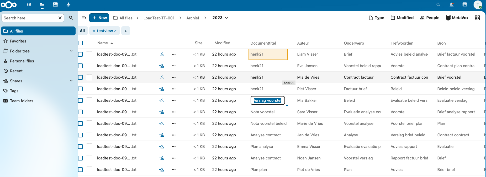
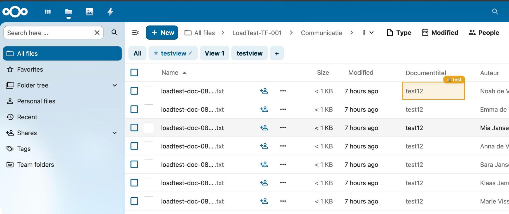

# Real-Time Metadata Sync & Cell Locking

MetaVox supports real-time metadata synchronization between users via Nextcloud's `notify_push` app. When one user edits metadata, the other users who have the same team folder open in the Files app see the change instantly. Additionally, cell locking prevents concurrent edits on the same field.



## Prerequisites

- **Nextcloud notify_push** app installed and configured
- **Redis** configured as distributed cache in Nextcloud (notify_push needs it; presence and cell locks live there too)
- **WebSocket reverse proxy** configured in Apache/Nginx
- **User status** app enabled (recommended): its heartbeat keeps track of who has a team folder open, see [Presence](#presence)

**Administration settings > Overview** shows MetaVox's setup checks: "MetaVox live
updates" (notify_push), "MetaVox presence" (User status app) and "MetaVox shared
cache" (distributed cache).

### Installation

```bash
# Install notify_push
sudo -u www-data php /var/www/nextcloud/occ app:install notify_push

# Copy binary
sudo cp /var/www/nextcloud/apps/notify_push/bin/x86_64/notify_push /usr/local/bin/notify_push
sudo chmod +x /usr/local/bin/notify_push

# Create systemd service
sudo tee /etc/systemd/system/notify_push.service << 'EOF'
[Unit]
Description=Nextcloud Push Notification Service
After=network.target

[Service]
Type=simple
User=www-data
ExecStart=/usr/local/bin/notify_push /var/www/nextcloud/config/config.php
Restart=always
RestartSec=5
Environment=PORT=7867

[Install]
WantedBy=multi-user.target
EOF

sudo systemctl daemon-reload
sudo systemctl enable --now notify_push

# Apache reverse proxy
sudo tee /etc/apache2/conf-available/notify_push.conf << 'EOF'
ProxyPass /push/ws ws://127.0.0.1:7867/ws
ProxyPass /push/ http://127.0.0.1:7867/
ProxyPassReverse /push/ http://127.0.0.1:7867/
EOF

sudo a2enmod proxy proxy_http proxy_wstunnel
sudo a2enconf notify_push
sudo systemctl restart apache2

# Configure
sudo -u www-data php /var/www/nextcloud/occ config:system:set trusted_proxies 0 --value='127.0.0.1'
sudo -u www-data php /var/www/nextcloud/occ config:app:set notify_push base_endpoint --value='https://your-domain.com/push'

# Verify
sudo -u www-data php /var/www/nextcloud/occ notify_push:self-test
```

All checks should show ✓.

---

## How It Works

### Real-Time Metadata Sync

```
User A saves metadata
    ↓
FieldService::saveValues()
    ↓
1. Database INSERT/UPDATE
2. Team folder's cache version bumped, search words updated
3. Changed file ids collected; at the end of the request one push
   event per team folder goes via Redis to the notify_push daemon,
   addressed to each user who has that team folder open
    ↓
notify_push daemon delivers via WebSocket
    ↓
User B's browser receives push event (file ids only, no values)
    ↓
MetaVox re-fetches the changed files it shows, through the API
(which checks User B's access to each file)
    ↓
Cells update in User B's grid view
```

### Presence

Pushes only go to users who have the grid of that team folder open. Nobody
there means no push; whoever opens the folder later loads fresh values.

- **Arriving**: listing a folder of the team folder in the Files app registers
  the user. No extra request.
- **Staying**: Nextcloud's own status heartbeat (User status app, every 5
  minutes while a tab is open) keeps the registration alive. MetaVox sends no
  heartbeat of its own. A registration ends 15 minutes after the last heartbeat.
- **Leaving**: switching to another team folder or closing the tab removes the
  registration (`POST /api/presence/leave`).
- **Without the User status app** there is no heartbeat, so a registration
  lasts 12 hours. Pushes then also reach users who left without closing the tab.

Presence lives in Nextcloud's distributed cache. With more than one web server,
that cache has to be shared (Redis); APCu is per server.

### Cell Locking



```
User A double-clicks a cell
    ↓
POST /api/groupfolders/{gfId}/files/{fileId}/lock
    ↓
Cache SET with 30s TTL: gf_{gfId}:{fileId}:{fieldName} = userId
    ↓
Push event "metavox_cell_locked" to the users who have the team folder open
    ↓
User B sees:
  - Orange background tint on the cell
  - Orange inset border (2px)
  - Cursor: not-allowed
  - A badge above the cell: "🔒 {user id}"
  - Double-click blocked
    ↓
User A closes the editor (save or cancel)
    ↓
POST /api/groupfolders/{gfId}/files/{fileId}/unlock
    ↓
Redis key deleted + push event "metavox_cell_unlocked"
    ↓
User B's cell returns to normal
```

### Crash Safety

If User A closes the browser tab or crashes without unlocking:
- The Redis lock key has a **30-second TTL** and expires automatically
- No stale locks — the cell becomes available again after 30 seconds
- No manual intervention needed

The lock is not renewed while the editor stays open: it also expires 30 seconds
after the editor opened.

A user who tries to edit a locked cell without having seen the push gets a 409
from the lock API; the cell then shows "Being edited by {user}" for 3 seconds
and the editor does not open.

---

## Technical Details

### Push Event Format

MetaVox uses the `notify_custom` Redis channel. The notify_push daemon routes events to specific users:

```php
// PHP: one message per user with the team folder open
$this->notifyQueue->push('notify_custom', [
    'user' => $userId,
    'message' => 'metavox_metadata_changed',
    'body' => [
        'gfId' => $groupfolderId,
        'fileIds' => [456, 457],
    ],
]);
```

The WebSocket message arrives as: `metavox_metadata_changed {"gfId":103,"fileIds":[456,457]}`

A metadata event carries no values, only the ids of the files changed in that
request. The browser fetches the values itself, so a user only ever sees values
of files they may read. Several saves in one request (bulk edit, defaults)
become one event per team folder.

Lock events carry the cell: `metavox_cell_locked {"gfId":103,"fileId":456,"fieldName":"status","userId":"alice"}`;
`metavox_cell_unlocked` has the same body without `userId`. They are sent right
away, not at the end of the request.

### WebSocket Message Parsing

Nextcloud's built-in push client strips the JSON body when dispatching to `_notify_push_listeners`. MetaVox intercepts the raw WebSocket `onmessage` handler to parse the full message including the body:

```javascript
ws.onmessage = (event) => {
    const raw = event.data  // "metavox_metadata_changed {"gfId":103,"fileIds":[456,457]}"
    const spaceIdx = raw.indexOf(' ')
    const eventName = raw.substring(0, spaceIdx)  // "metavox_metadata_changed"
    const body = JSON.parse(raw.substring(spaceIdx + 1))  // {gfId: 103, fileIds: [456, 457]}
}
```

### Lock API

| Method | Endpoint | Body | Response |
|--------|----------|------|----------|
| POST | `/api/groupfolders/{gfId}/files/{fileId}/lock` | `{field_name: "doc_title"}` | `{locked: false}` (acquired) or `409 {locked: true, lockedBy: "user"}` |
| POST | `/api/groupfolders/{gfId}/files/{fileId}/unlock` | `{field_name: "doc_title"}` | `{success: true}` |

### Lock Storage

Locks are stored in Nextcloud's distributed cache (Redis), in the `metavox_locks` cache:
- **Key**: `gf_{groupfolderId}:{fileId}:{fieldName}`
- **Value**: `userId`
- **TTL**: 30 seconds (auto-expires)

---

## Performance & Scalability

### Push Events

| Metric | Value | Notes |
|--------|-------|-------|
| Event size | ~100 bytes for one file | JSON with gfId + fileIds; grows with the number of files changed in the request |
| Redis PUBLISH latency | ~0.1ms per user | Constant regardless of payload size |
| WebSocket delivery | ~10ms | Depends on network latency |
| 100 users with the team folder open | ~10ms total | 100 Redis PUBLISH calls |
| 2,000 users with the team folder open | ~200ms total | 2000 Redis PUBLISH calls |
| Team folder open by nobody | 0 | No push is sent |

Members who don't have the team folder open receive nothing, however large the
team folder's membership.

### Cell Locking

| Operation | Backend Cost | Network Cost |
|-----------|-------------|--------------|
| Lock acquire | 1 cache GET + 1 cache SET | 1 POST request |
| Lock check (another user tries) | 1 cache GET | 1 POST request (409 response) |
| Unlock | 1 cache GET + 1 cache DELETE | 1 POST request |
| Push notification per lock/unlock | Same as above push events | WebSocket (no HTTP) |

### Concurrent Editing Scenarios

| Scenario | Behavior |
|----------|----------|
| 2 users, same cell | Second user sees lock indicator, cannot edit |
| 2 users, different cells | Both edit independently, see each other's changes in real-time |
| 50 users, same folder | All see metadata changes instantly, locks prevent conflicts |
| User crashes mid-edit | Lock expires after 30s, cell becomes available |
| notify_push not installed | Graceful fallback — no real-time sync, manual refresh needed; locks still refuse a second editor |

### Redis Memory Usage

- Each lock: ~100 bytes (key + value)
- 1,000 concurrent edits: ~100 KB
- Locks expire after 30s — no accumulation

### WebSocket Connections

notify_push uses a single Rust daemon that handles all connections:
- Memory: ~5 KB per connected browser
- 10,000 connected browsers: ~50 MB RAM
- CPU: negligible (event routing only)

---

## Graceful Degradation

If `notify_push` is not installed:
- **No real-time sync** — users must refresh to see other users' changes
- **Cell locking still applies, without the indicator** — locks are kept in the distributed cache, not in notify_push. A second user sees no lock badge, but trying to edit the cell gets "Being edited by {user}"
- **No errors** — all push-related code handles missing `notify_push` gracefully
- **Full functionality otherwise** — inline editing, views, filters all work normally

Without any distributed cache (no `memcache.distributed` and no local cache to
fall back to), locks are not kept and the lock API always grants them.

The PushService constructor wraps the `IQueue` resolution in a try-catch:
```php
try {
    $this->notifyQueue = \OCP\Server::get(\OCA\NotifyPush\Queue\IQueue::class);
} catch (\Throwable $e) {
    // notify_push not installed: push is best effort
}
```

---

## Troubleshooting

### Push events not arriving

1. Check notify_push self-test: `occ notify_push:self-test` — all checks should be ✓
2. Check that the receiving user has the team folder open in the Files app: pushes only go to users registered as present
3. Check WebSocket connection in browser: `console.log(window._notify_push_ws?.readyState)` — should be `1` (OPEN)
4. Check listener registration: `console.log(window._notify_push_ws?._metavoxPatched)` — should be `true`
5. Check daemon logs: `journalctl -u notify_push -f`

### Lock indicator not showing

1. Verify the push event arrives: intercept WebSocket with `ws.onmessage` logging
2. Check if cell selector matches: `document.querySelector('.metavox-col[data-file-id="123"]')`
3. Ensure two different users are testing (same user's own locks are hidden)

### Stale data after edit

- Server-side per-file cache has been removed — all metadata reads go directly to the database
- The Files app gets values with the folder listing; navigating to the folder again, or a refresh, loads them fresh
- A local edit wins over older data for 60 seconds, so a listing that was underway during the save does not bring the old value back
