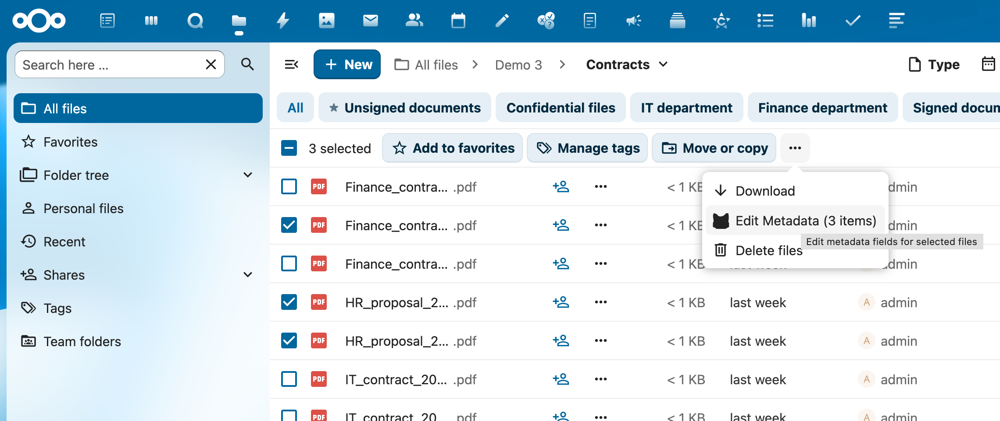
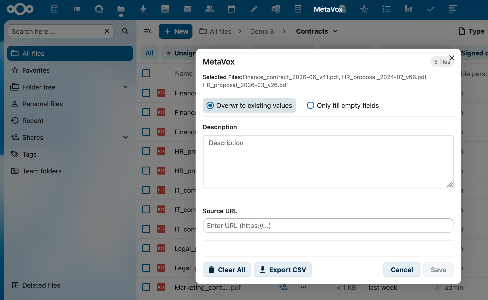

# Bulk Metadata Editor

MetaVox allows you to edit metadata for multiple files at once using the Bulk Metadata Editor. This feature is available from the Files app toolbar when you select two or more files or folders.

---

## Accessing the Bulk Editor

1. Navigate to a Team folder in the Files app
2. Select two or more files using checkboxes or Ctrl/Cmd+click
3. Click **"Edit metadata ({count} items)"** in the toolbar above the file list (it may be under the **…** menu)

---

## Using the Bulk Editor

The **Edit metadata** dialog opens. At the top it lists the names of the selected files (the first five, then a count of the rest). Below that you see the file metadata fields of the Team folder; Team folder metadata can't be changed here.

### Finding Fields

When a Team folder has more than 6 metadata fields, a **Search fields** box appears at the top of the dialog. Type to filter fields by name — the search is case-insensitive and matches on both field label and internal name.

### Editing Fields

- Fill in the fields you want to update
- Leave fields empty if you don't want to change them
- All selected files will receive the same values
- Click **Save**. The button stays disabled until you fill in a field. Afterwards you see *Metadata saved for {count} files*.
- Files you don't have write access to are skipped

### Merge Strategies

Choose how to handle existing metadata values:

| Strategy | Description |
|----------|-------------|
| **Overwrite existing values** | Replaces all existing values with the new values you enter |
| **Only fill empty fields** | Only updates fields that are currently empty, preserving existing values |

---

## Additional Actions

### Clear All Metadata

Click the **"Clear all"** button to remove all metadata from the selected files.

- A confirmation dialog asks *Clear all metadata from {count} files? This cannot be undone.* Click **Clear metadata** to go ahead, or **Cancel**
- Required fields keep their value: clearing all is no way around them
- This also clears the search index entries for the files

### Export to CSV

Export metadata from the selected files to a CSV file. See [Exporting Data](exporting-data.md) for details.

---

## Tips

- **Large selections**: The bulk editor works efficiently with many files, but for very large selections (100+), consider processing in batches
- **Required fields**: A field you leave empty stays as it is on every file, in both modes. A required checkbox cannot be set to unticked
- **Undo**: There is no undo function - use "Only fill empty fields" if you want to preserve existing data

---

## See Also

- [Exporting Data](exporting-data.md) - Export metadata to CSV
- [Field Types](field-types.md) - All available field types
- [API Reference](../architecture/api-reference.md) - Batch operations via API
