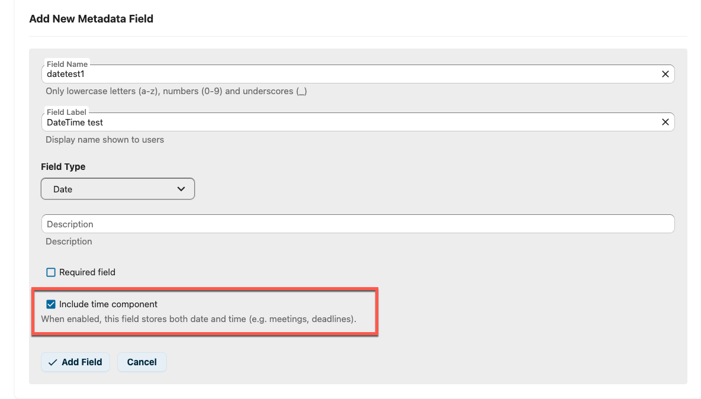
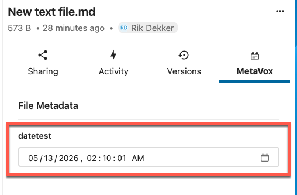
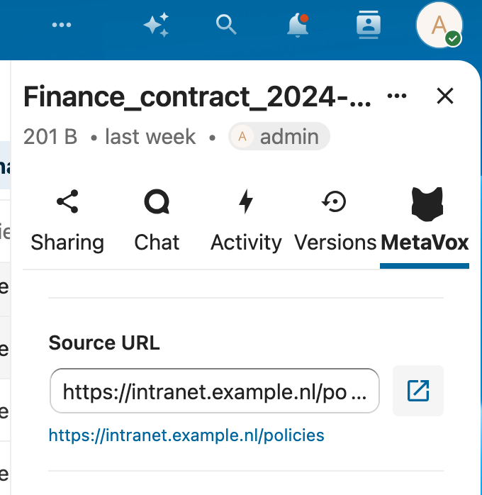
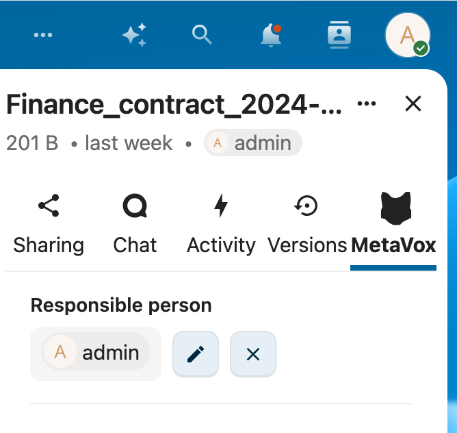
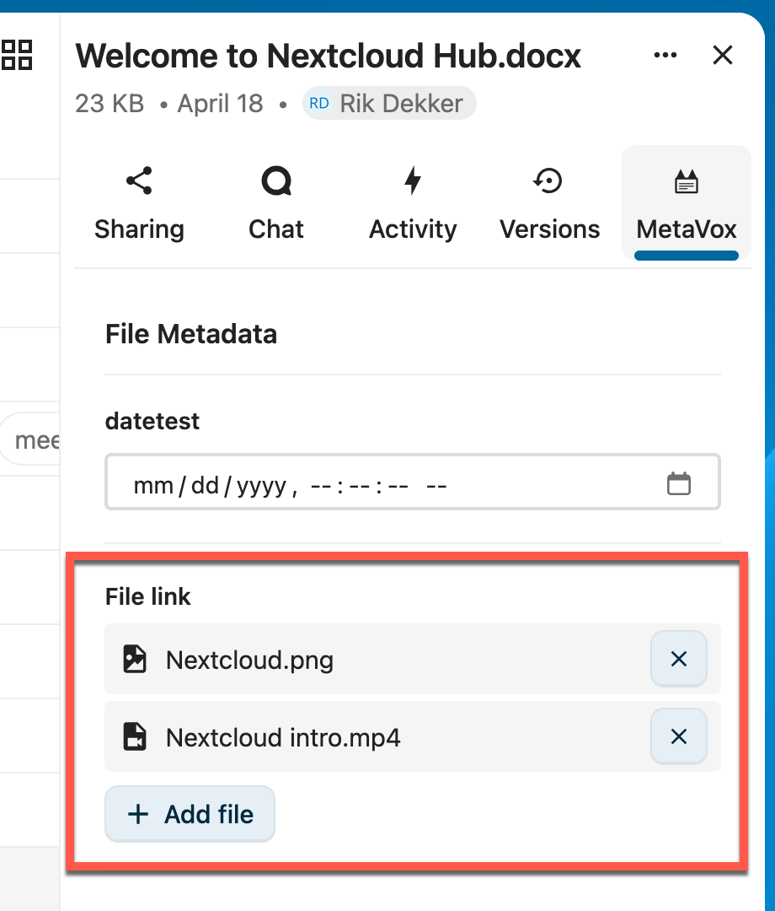
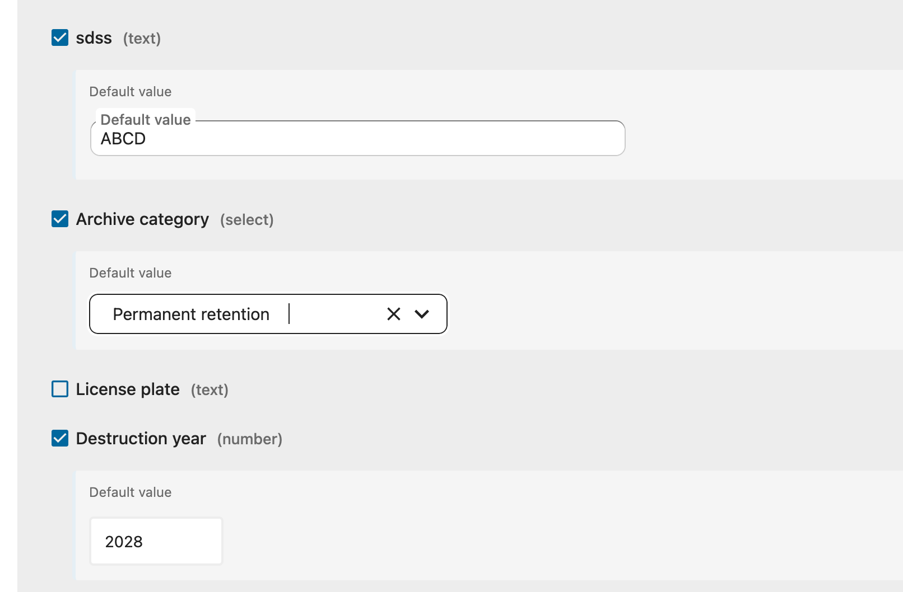

# MetaVox Field Types

MetaVox supports various field types for capturing metadata on Team folders and documents. This guide describes each field type and its usage.

---

## Basic Field Types

### Text
A simple single-line text input for short values.

**Use cases:** Title, author name, document ID, short descriptions

**Example:** "Q4 Budget Report"

**Options:** None

---

### Long Text (Textarea)
A multi-line text input for longer content.

**Use cases:** Descriptions, notes, summaries, comments

**Example:** "This document outlines the proposed budget for Q4, including projections for..."

**Options:** None

---

### Number
Numeric input that only accepts numbers.

**Use cases:** Version numbers, counts, quantities, years

**Example:** `42`

**Options:** None

---

### Date
A date picker for selecting dates. Optionally, the field can also capture a time component.

**Use cases:** Publication date, expiry date, review date, meeting start, deadlines

**Examples:**
- Date only: `2026-04-15`
- Date + time: `2026-04-15T14:30:00`

**Options:**
- **Include time component** (default: off) — captures hours, minutes and seconds in
  addition to the date. Stored as a floating ISO 8601 string (no timezone), matching
  SharePoint's `SPFieldDateTime` with `DisplayFormat = DateTime`.

When creating or editing a Date field in admin settings, tick **Include time component**
to enable the time portion:

In the file sidebar and inline grid editor, the field then renders as a datetime picker
that captures both date and time:

**SharePoint migration note:** Columns with `DisplayFormat = DateOnly` map to MetaVox
Date fields with this option **off**; `DateTime` maps to **on**. Existing pre-2.1.0
Date fields render as date-only — no data migration is performed. CSV import support is
planned for a future release.

---

### Checkbox
A boolean yes/no toggle.

**Use cases:** Approved status, confidential flag, published status

**Example:** ✅ (checked) or ☐ (unchecked)

**Options:** None

A checkbox is never required: it always has an answer, checked or not. The **Required field** switch does not appear for it.

---

### Select (Dropdown)
A dropdown menu with predefined options. Users can select one value.

**Use cases:** Status, category, department, document type

**Example:** "In Review" (from options: Draft, In Review, Approved, Archived)

**Options:** Enter the choices one per row under **Dropdown options** in the field configuration. Click **Add option** for each extra choice. A field needs at least one option.

---

### Multi-select
Similar to Select, but allows multiple selections.

**Use cases:** Tags, applicable departments, related topics

**Example:** "Legal, Finance" (from options: Legal, Finance, HR, IT)

**Options:** Enter the choices one per row under **Dropdown options** in the field configuration. Click **Add option** for each extra choice. A field needs at least one option.

---

## Advanced Field Types

### URL
A URL input field with validation and a clickable external link button.

**Use cases:** Source links, reference URLs, related resources

**Features:**
- URL format validation
- Click button to open link in new tab

---

### People and groups
Select Nextcloud accounts, groups or teams from a searchable dropdown. Shows avatars, and an icon for a group or team.

**Use cases:** Document owner, reviewer, responsible person or team, who is involved

**Features:**
- Searchable list, as when you share a file: you find whom you could share with
- Shows the display name, never the account id
- **Can hold:** accounts, groups and teams; an administrator ticks which. Teams need the Teams app
- **Allow more than one:** more than one in the same field. Turned off later, a file that holds more than one keeps them until someone edits the value
- *Assigned to you* also counts your groups and teams
- A team you cannot see shows as *Unavailable team*

---

### File Link
Browse and link to one or more files or folders within Nextcloud using the native file picker.

**Use cases:** Related documents, source files, attachments, parent documents

**Features:**
- Native Nextcloud file picker integration
- **Multiple files per field** — use **Add file** to link several files; remove any with the **×** button
- Links are stored by **file ID**, so a reference keeps working after the target file is renamed or moved
- Only files and folders inside the same Team folder can be linked
- A file can't be linked to itself
- The same file can't be added twice (duplicates are rejected)
- Click a linked file to open it
- If a linked file was deleted or you no longer have access to it, it shows as **Unavailable file**
- **Linked from** — in the sidebar of a linked file you can see which files link to it (backlinks)

> Single-file links created with older versions keep working unchanged; you can add more files to them at any time.

---

## Field Configuration

When creating a field in the admin settings, you can configure:

| Setting | Description |
|---------|-------------|
| **Field name** | Internal identifier. Only lowercase letters (a-z), numbers (0-9) and underscores (_), starting with a letter |
| **Field label** | Display name shown to users |
| **Field type** | One of the types described above |
| **Description** | Help text shown below the field |
| **Required field** | Whether the field must be filled in. Not shown for a Checkbox, which is never required |
| **Dropdown options** | For Select and Multi-select fields: one choice per row, added with **Add option** |

---

## Default Values

Each Team folder can give its assigned file fields a **default value**. New files in
that folder automatically receive the defaults, and existing files without a value
are back-filled in the background — so a folder's documents start out consistently
classified without manual data entry.

Defaults are configured **per Team folder**, with a type-correct input for every
field type (text, number, date/time, dropdown, multi-select, checkbox, URL, people
and groups, file link):

- Tick a field and enter its default in the **Default value** input that appears.
- Leave the input empty to clear a default.
- After saving, use **Apply defaults now** to back-fill existing files immediately
  (otherwise a background job applies them within a few minutes).

**Who can set defaults:** administrators (for any folder) and members with the
MetaVox manage permission who may change the folder. The latter configure fields and defaults
for their folder from **Settings → Personal → MetaVox**, which lists only the
folders they may manage. See [Permissions](../admin/permissions.md).

---

## Field Scopes

MetaVox supports two scopes for metadata:

### Team Folder Metadata
Metadata that applies to the entire Team folder. Visible on all documents within the folder (read-only at document level).

### Document Metadata
Metadata specific to individual documents within a Team folder. Editable by users with document edit permissions.

---

## See Also

- [User Overview](overview.md) - Getting started with metadata
- [Views](views.md) - Filtering and sorting by field values
- [Highlight Rules](highlight-rules.md) - Coloring cells by their value
- [Bulk Editing](bulk-editing.md) - Edit fields for multiple files
- [Exporting Data](exporting-data.md) - Export metadata to CSV
