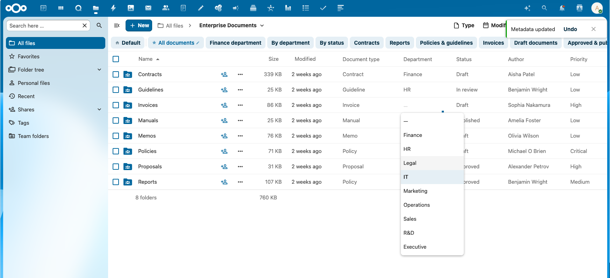
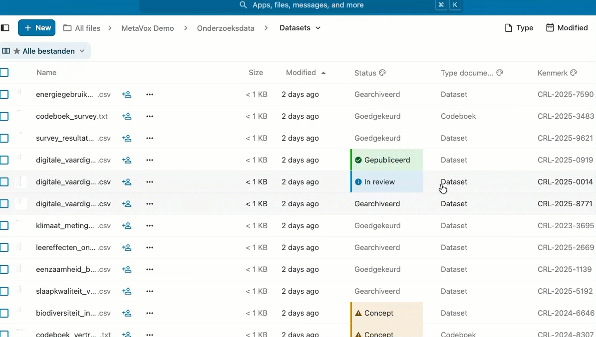

# MetaVox gebruikersgids

MetaVox helpt je documenten te organiseren en classificeren door **metadata** toe te voegen — gestructureerde informatie over je bestanden.

## Waarom metadata?

Documenten hebben vaak context nodig buiten hun inhoud:

- Wie is verantwoordelijk voor dit document?
- Is het goedgekeurd of nog concept?
- Wanneer moet het herzien worden?
- Is het vertrouwelijk of publiek?

MetaVox legt deze informatie gestructureerd en doorzoekbaar vast.

## Metadata bekijken

1. Navigeer naar een bestand of map in een Team folder
2. Open de zijbalk (info-icoon of druk `i`)
3. Open het tabblad **MetaVox**

Je ziet twee soorten metadata:

### Team folder-metadata

- Geldt voor de hele Team folder
- Ingesteld door beheerders
- Read-only voor reguliere gebruikers
- Verschijnt bovenaan het MetaVox-tabblad, onder **Teammap-metadata**. Klik op de kop om het in te klappen.

### Bestandsmetadata

- Specifiek voor dit bestand
- Bewerkbaar als je schrijfrechten hebt
- Verschijnt onder de Team folder-metadata, onder **Bestandsmetadata** (of **Mapmetadata** bij een map)

Verwijzen andere bestanden via een Bestandslink-veld naar dit bestand, dan staan ze onder **Gelinkt vanuit**. Klik op een naam om dat bestand te openen.

## Metadata bewerken

De zijbalk toont de waarden; bewerken doe je in een dialoogvenster. Als je bewerkrechten hebt op het bestand:

1. Open de zijbalk van het bestand
2. Open het tabblad **MetaVox**
3. Klik op de potloodknop naast **Bestandsmetadata** (**Metadata van dit bestand bewerken**)
4. Voer waarden in of kies ze. De beschrijving van een veld staat eronder.
5. Klik op **Opslaan**. **Annuleren** sluit het venster zonder op te slaan.

**Opslaan** blijft uitgeschakeld tot je een waarde wijzigt. Na het opslaan zie je *Metadata opgeslagen*. Heeft je beheerder AI ingeschakeld, dan staat er ook een knop **Genereren met AI** in het venster; zie [AI-autofill](../features/ai-autofill.md).

### Veldtypen

Verschillende velden accepteren verschillende soorten input:

| Type | Voorbeeld |
|------|-----------|
| Tekst | Korte beschrijvingen, titels |
| Lange tekst | Langere notities, samenvattingen |
| Nummer | Versienummers, aantallen |
| Datum | Deadlines, herzieningsdata |
| Dropdown | Status (Concept/Goedgekeurd/Gearchiveerd) |
| Meerkeuze | Meerdere categorieën |
| Selectievakje | Ja/Nee-vlaggen |
| URL | Links naar externe bronnen |
| Gebruiker | Selecteer een Nextcloud-gebruiker |
| Bestandslink | Links naar bestanden of mappen in dezelfde Team folder |

Zie [Veldtypen](field-types.md) voor uitgebreide informatie.

## Werken in de bestandenlijst

MetaVox-velden kunnen ook als kolommen in de bestandenlijst van een Team folder staan. Welke kolommen je ziet, hangt af van de actieve [weergave](views.md).

### Een cel bewerken

- Dubbelklik op een cel om een editor voor het veldtype te openen (tekstveld, dropdown, datumkiezer, etc.). Met het toetsenbord ga je naar de cel en druk je op `Enter` of `F2`.
- Druk op `Enter` om op te slaan of op `Escape` om te annuleren. Een optie kiezen in een dropdown slaat die meteen op.
- Je kunt alleen cellen bewerken van bestanden waarop je schrijfrechten hebt.

In actie:

### Een waarde naar beneden kopiëren

Terwijl de editor van een cel open is, staat rechtsonder in de cel een klein vierkantje. Sleep het naar beneden om de waarde naar de cellen eronder te kopiëren, zoals de vulgreep in een spreadsheet. Cellen van bestanden die je niet mag bewerken worden overgeslagen.

### Ongedaan maken

Na een wijziging in de bestandenlijst verschijnt onderin het scherm een melding: *Metadata bijgewerkt*, of *{count} cellen bijgewerkt* na het naar beneden kopiëren. Klik in die melding op **Ongedaan maken** om de oude waarden terug te zetten. Alleen de laatste wijziging kun je zo terugdraaien.

### Sorteren

- Klik op de kop van een MetaVox-kolom om op dat veld te sorteren. Klik nog een keer om de volgorde om te draaien.
- Sorteren op een kolom van de Files-app, zoals Naam of Gewijzigd, beëindigt de MetaVox-sortering.
- Konden niet alle waarden worden geladen, dan zie je *Sorteren en filteren op MetaVox-kolommen is gepauzeerd: niet alle waarden konden worden geladen.* De lijst houdt dan zijn huidige volgorde. Open de map opnieuw om het nog eens te proberen.

### Lange waarden

Een waarde van meer dan 512 tekens wordt in de lijst ingekort en eindigt op "…". Beweeg de muis over de cel om *Ingekort. De volledige waarde wordt geladen als je de cel bewerkt.* te zien. Een ingekorte link is niet klikbaar. Open de editor om de volledige waarde te zien en te wijzigen.

### Gemarkeerde cellen

Een weergave kan cellen kleuren op hun waarde, bijvoorbeeld een verlopen deadline rood. Een kolom met zulke regels toont een icoon naast de naam. Zie [Cellen markeren](highlight-rules.md).

### Tegelijk bewerken

Is iemand anders een cel aan het bewerken, dan opent die niet voor jou. De cel laat dan zien wie ermee bezig is: *Wordt bewerkt door {user}*. Heeft je beheerder [real-time sync](../features/real-time-sync.md) ingericht, dan verschijnen wijzigingen van anderen in je lijst zonder de pagina te herladen.

## Meerdere bestanden tegelijk bewerken

Metadata bijwerken voor veel bestanden in één keer? Gebruik de bulk-editor:

1. Selecteer twee of meer bestanden in de lijst
2. Klik **Metadata bewerken ({count} items)** in de toolbar boven de bestandenlijst (mogelijk onder het **…**-menu)
3. Vul de velden in die je wilt bijwerken
4. Kies een merge-strategie (**Bestaande waarden overschrijven** of **Alleen lege velden invullen**)
5. Klik **Opslaan**

Zie [Bulk-bewerken](bulk-editing.md) voor details.

## Weergaven gebruiken

Weergaven laten je wisselen tussen voor-gedefinieerde combinaties van kolommen, filters, sortering en gemarkeerde cellen. Je beheerder maakt weergaven per Team folder voor verschillende workflows.

Zie [Weergaven](views.md) voor details.

## Tips

- **Verplichte velden** zijn gemarkeerd met een asterisk (*). Het bewerkvenster slaat pas op als elk verplicht veld een waarde heeft en elk verplicht vinkje aan staat, en zegt onder het veld wat er ontbreekt. In het raster is een lege verplichte cel gemarkeerd, en een verplicht veld kan daar niet leeg
- **Beschrijvingen** verschijnen onder velden om uit te leggen wat je moet invoeren
- **Dropdowns** tonen voor-gedefinieerde opties — je kunt geen eigen waarden invoeren
- **Zijbalkwijzigingen vragen om Opslaan** — in het bewerkvenster wordt niets bewaard tot je op **Opslaan** klikt; in de bestandenlijst slaat een wijziging op zodra je op `Enter` drukt of een optie kiest

## Hulp nodig?

- Bekijk de [Snelstart-gids](../getting-started.md) voor een introductie

Neem contact op met je Nextcloud-beheerder als:

- Je andere metadata-velden nodig hebt
- Je velden niet kunt bewerken die je wel zou moeten kunnen bewerken
- Je vragen hebt over welke waarden je moet invoeren

## Zie ook

- [Veldtypen](field-types.md) — Alle beschikbare veldtypen
- [Weergaven](views.md) — Wisselen tussen voor-gedefinieerde weergaven
- [Cellen markeren](highlight-rules.md) — Cellen gekleurd op hun waarde
- [Metadata doorzoeken](search.md) — Bestanden vinden op hun metadata
- [Bulk-bewerken](bulk-editing.md) — Metadata voor meerdere bestanden bewerken
- [Data exporteren](exporting-data.md) — Metadata exporteren naar CSV
- [AI-autofill](../features/ai-autofill.md) — AI-gedreven metadata-suggesties
- [Real-time sync](../features/real-time-sync.md) — Collaboratief bewerken met cell-locking
