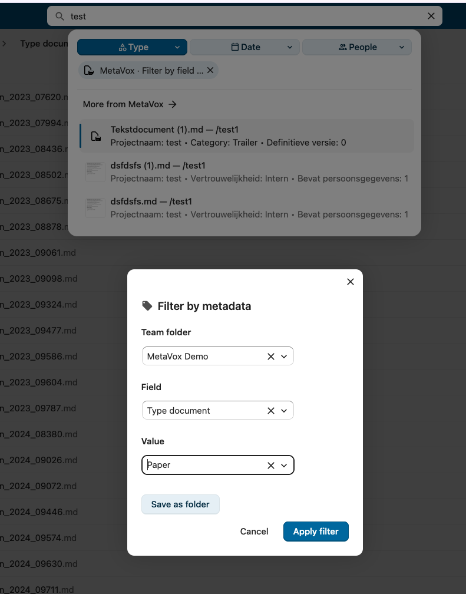
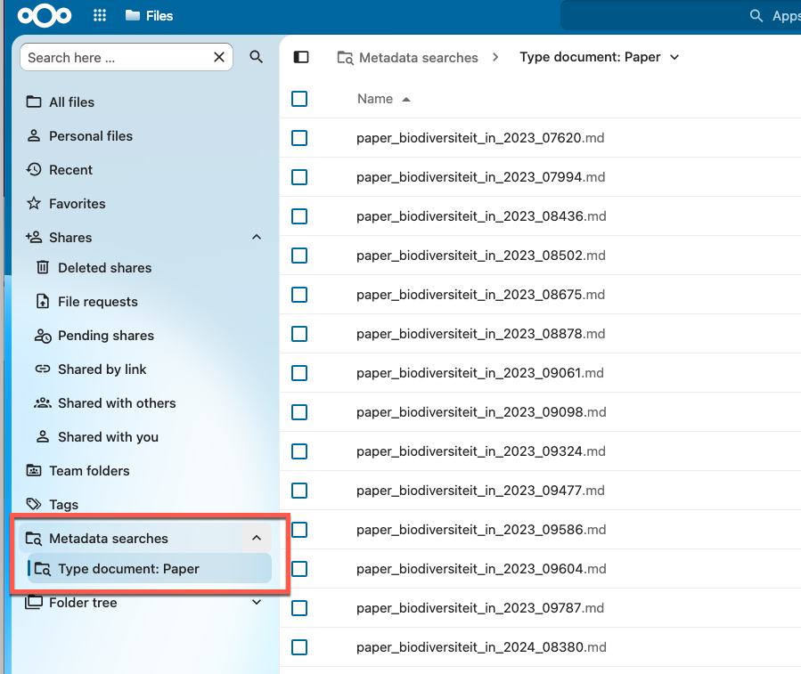

# Metadata doorzoeken

MetaVox integreert met de **Geünificeerd zoeken** van Nextcloud (het vergrootglas /
`Ctrl/Cmd + K`), zodat je bestanden op hun metadata kunt vinden vanaf elke plek in Nextcloud —
niet alleen binnen een Team folder.

Er zijn twee manieren om te zoeken:

1. **Vrije tekst** — typ een of meer woorden en MetaVox geeft bestanden terug met een veld waarin ze staan.
2. **Filteren op veld** — kies een specifiek veld en waarde via de actie **MetaVox · Filter op veld…**.



---

## Vrije-tekst-zoeken

Open zoeken (`Ctrl/Cmd + K`), typ een term en kijk onder de sectie **MetaVox** in de
resultaten. Elk resultaat toont het bestand, met het **matchende veld** vooraan in de
subregel (zoeken op `Mercedes-Benz` toont bijvoorbeeld `Make: Mercedes-Benz`). De subregel toont maximaal drie velden.

- Typ minstens 3 tekens. MetaVox gebruikt de eerste 5 woorden van je zoekopdracht en negeert de rest.
- Woorden matchen vanaf hun begin, hoofdletters maken niet uit: `merc` vindt `Mercedes-Benz`, `cedes` niet.
- Alle woorden moeten in hetzelfde veld staan: `klant 042` vindt `Klant 042`, niet een bestand met `Klant 7` in het ene veld en `042` in het andere.
- Je vindt alleen bestanden in je eigen Team folders die je kunt openen.
- Datum-, getal-, checkbox- en bestandslinkvelden worden niet als tekst doorzocht; gebruik daarvoor **Filter op veld**.
- De nieuwste bestanden komen eerst, per pagina: **Laad meer resultaten** toont de volgende. Bij een woord dat in heel veel bestanden staat, zie je recente treffers; voeg een woord toe om te verfijnen.
- Vrije-tekst-zoeken gebruikt een woordindex die MetaVox bijwerkt zodra waarden veranderen. Na een update van MetaVox of het terugzetten van een back-up wordt de index op de achtergrond opnieuw opgebouwd; tot dat klaar is, kunnen sommige bestanden in de resultaten ontbreken.

Tenzij je beheerder het metadatafilter heeft uitgezet, kun je ook een precieze `veld:waarde`-zoekopdracht rechtstreeks in de zoekbalk typen, bijvoorbeeld:

```
archive_category:Permanent retention
```

---

## Filteren op veld

Voor een begeleid, exact filter gebruik je de actie **MetaVox · Filter op veld…** in de
zoekbalk (tenzij je beheerder die heeft uitgezet). Die opent het keuzescherm **Filteren op metadata**:

1. **Teammap** — kies een van de teammappen waar je lid van bent, of **Al mijn teammappen**
   om ze allemaal tegelijk te doorzoeken.
2. **Veld** — kies een van de metadatavelden van die folder (bij al je teammappen: de velden van
   allemaal).
3. **Waarde** — kies uit de waarden die **daadwerkelijk voorkomen** in de folder (zodat een
   filter nooit op een leeg resultaat uitkomt), of typ er een voor vrije-tekst-velden. Bij al je
   teammappen biedt een keuzeveld zijn opties aan en typ je andere waarden zelf. Bij een
   meerkeuzeveld kun je meerdere opties kiezen: bestanden met **een van** die opties worden gevonden.

Bevestig met **Filter toepassen**. Er verschijnt een filter-chip in de zoekbalk en de
matchende bestanden worden onder **MetaVox** getoond, de nieuwste bestanden eerst, per pagina:
**Laad meer resultaten** toont de volgende. Nextcloud zoekt alleen als er een woord in de
zoekbalk staat, dus MetaVox zet de gekozen waarde daar neer; staat je Nextcloud-versie dat niet
toe, dan vraagt een melding je zelf een woord te typen.

> **Bestandslink**-velden worden niet aangeboden in het keuzescherm: hun opgeslagen waarde is
> een interne bestandsverwijzing, niet een waarde waarop je zou filteren.

---

## Een filter bewaren als map

Vanaf Nextcloud 33, als je beheerder het heeft aangezet, heeft het keuzescherm ook
**Opslaan als map**. Dat bewaart de Team folder,
het veld en de waarde als een eigen zoekopdracht en opent die in Bestanden, onder
**Metadata-zoekopdrachten** in de navigatie. De zoekopdracht draait opnieuw elke keer dat je de
map opent, dus nieuwe bestanden met die waarde verschijnen vanzelf.



- De map toont de nieuwste 500 bestanden die passen; zijn het er meer, dan meldt een bericht dat.
  Maak de zoekopdracht nauwer om de rest te zien.
- De kolom **Locatie** laat zien waar elk bestand staat. Een map tussen de resultaten opent waar
  hij staat.
- Verwijder een bewaarde zoekopdracht met **Bewaarde zoekopdracht verwijderen** in het menu. De
  bestanden blijven waar ze zijn.
- Je bewaarde zoekopdrachten zijn alleen van jou: niemand anders ziet ze. Een map toont de
  bestanden die het filter voor jou zou vinden, volgens de regels hieronder.
- Shares, reacties, tags, herinneringen en vergrendelingen zie je niet in deze weergave, zodat die
  snel blijft; de eigen map van het bestand en de zijbalk laten ze zien.
- Herlaad je de pagina terwijl de details of het voorbeeld van een bestand open staan, dan kom je in de eigen map van dat bestand.

---

## Wat je ziet en wat privé blijft

- Resultaten zijn beperkt tot de **Team folders waar je lid van bent**, en tot de bestanden die
  je daar kunt openen: wat de geavanceerde rechten van een Team folder voor je verbergen, wordt
  nooit gevonden. Dat geldt ook voor beheerders.
- De subregel toont de eigen waarden van het bestand in de Team folder waar jij het ziet.
- Bestanden met dezelfde naam worden onderscheiden door hun folder in de resultaattitel te tonen.

---

## Zie ook

- [Veldtypen](field-types.md) — De velden waarop je kunt zoeken en filteren
- [Weergaven](views.md) — Vooraf ingestelde filters en kolommen binnen een Team folder
- [Gebruikersoverzicht](overview.md) — Aan de slag met metadata
