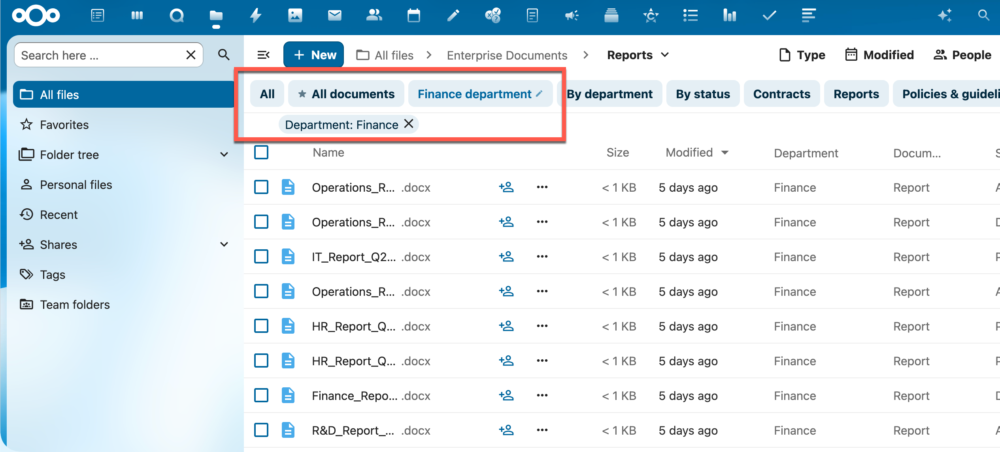
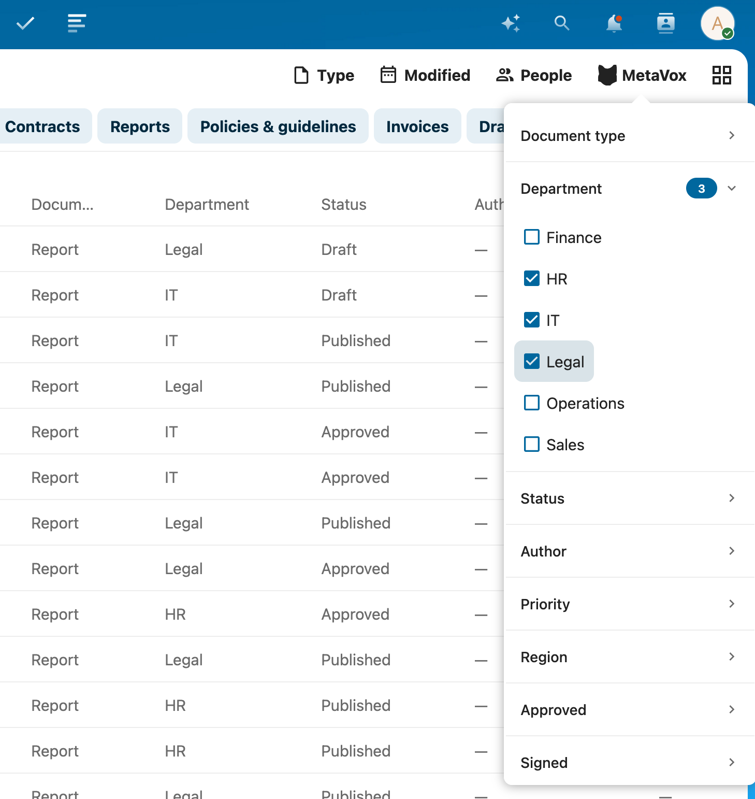

# Weergaven

Weergaven laten je snel wisselen tussen voor-gedefinieerde combinaties van kolommen, filters en sortering binnen een team folder.

## Wat is een weergave?

Een weergave definieert:

- Welke metadata-kolommen zichtbaar zijn in de bestandenlijst
- De volgorde van die kolommen
- Welke filters voor-ingesteld zijn
- Hoe bestanden worden gesorteerd
- Welke cellen gemarkeerd worden

Weergaven gelden per team folder en zijn gedeeld door iedereen in die folder. Elke team folder kan meerdere weergaven hebben voor verschillende workflows of doelgroepen.

Weergaven worden aangemaakt en gewijzigd door wie weergaven mag beheren: leden met schrijfrecht op de team folder zelf, en Nextcloud-beheerders. Zie [Weergaven beheren](../admin/views.md).

## Tussen weergaven wisselen

Boven de bestandenlijst toont de weergavekiezer de naam van de weergave waarin je zit. Klik erop om het menu te openen:

| Menu-item | Wat het doet |
|-----------|--------------|
| **Standaard** | Verlaat alle weergaven: de gewone bestandenlijst zonder MetaVox-kolommen |
| Naam van een weergave | Wisselt naar die weergave; een vinkje toont de huidige |
| ★ naast een weergave | Dit is de standaardweergave, die automatisch opent |
| **Filters bewaren als weergave …** | Bewaart de filters die je zette als weergave (zie hieronder) |
| **Bewerken …** | Opent de huidige weergave in de editor (wie weergaven mag beheren) |
| **Details bekijken** | Toont de instellingen van de huidige weergave, alleen-lezen (alle anderen) |
| **Nieuwe weergave** | Maakt een nieuwe weergave (wie weergaven mag beheren) |

**Bewerken …** en **Details bekijken** verschijnen alleen als je in een weergave zit, niet in **Standaard**.

### Welke weergave opent

Als je een team folder opent:

1. Een link die een weergave noemt, opent die weergave.
2. Een submap openen houdt de weergave waarin je zat, en houdt **Standaard** als je daarvoor koos.
3. Anders opent de standaardweergave (★). Heeft de team folder geen standaardweergave, dan zie je **Standaard**.

In **Standaard** toont de bestandenlijst geen MetaVox-kolommen, maar biedt het MetaVox-filter alle velden van de team folder.

## Filters tijdelijk aanpassen

Met de **MetaVox**-knop in de Nextcloud-filterbalk filter je bovenop de actieve weergave.

1. Klik op de **MetaVox**-knop in de filterbalk
2. Klik op een veldnaam om de filter-opties voor dat veld uit te klappen
3. Vink één of meerdere waarden aan
4. De bestandenlijst werkt direct bij

Elk veld is een inklapbare sectie. Een stip naast de veldnaam toont dat het veld actieve filter-waarden heeft.

Filters die zo zijn ingesteld zijn **tijdelijk**. Ze worden niet opgeslagen in de weergave en verdwijnen als je van weergave wisselt of een andere map opent. Wil je ze houden, bewaar ze dan als weergave.

In een weergave toont het paneel de velden die de weergave als filterbaar markeert. Zijn die er niet, dan staat er "Geen filters in deze weergave".

### Filteren op meerdere waarden

Binnen één veld werkt het selecteren van meerdere waarden als OR — bestanden die match'en met **een van** de aangevinkte waarden worden getoond.

Tussen verschillende velden werken filters als AND — bestanden moeten match'en met de actieve filter voor **elk** veld.

### Ja / Nee-filtering

Voor checkbox-velden (Ja/Nee) kun je filteren op:

- **Ja** — bestanden waarbij het veld aangevinkt is
- **Nee** — bestanden waarbij het veld uit staat of geen waarde heeft

Beide opties zijn altijd beschikbaar, ongeacht welke waarden in de folder voorkomen.

### Filters wissen

Elk actief filter staat als chip boven de bestandenlijst, bijvoorbeeld "Afdeling: Financiën".

- Klik op de **✕** van een chip om het filter voor dat veld te verwijderen
- **✕ Alles wissen** (zichtbaar als filters op meer dan één veld actief zijn) verwijdert alle filters in één keer

Filters wissen verandert de sortering niet.

## Filters bewaren als weergave

Mag je weergaven beheren, dan kun je de filters die je zette bewaren. **Filters bewaren als weergave …** verschijnt in het weergavemenu zodra je filters afwijken van die van de huidige weergave.

Het venster **Bewaren als weergave** toont welke filters bewaard worden. In een weergave kies je:

- **“{name}” bijwerken** — de filters vervangen die van de huidige weergave. Kolommen en sortering blijven. Iedereen met toegang ziet de wijziging.
- **Nieuwe weergave maken** — voer een naam in. De huidige weergave blijft zoals hij is.

In **Standaard** worden de filters altijd als nieuwe weergave bewaard. Een nieuwe weergave krijgt de kolommen die je nu ziet, geen sortering, en is niet de standaardweergave. Na het bewaren zit je in de bewaarde weergave.

## Sorteren

Klik op de kop van een MetaVox-kolom om erop te sorteren; klik nog eens om de volgorde om te draaien. Klik je op een Files-kolom zoals Naam of Gewijzigd, dan stopt de MetaVox-sortering. Een weergave kan ook een eigen sortering hebben; die geldt zodra je naar de weergave wisselt.

## Standaardweergave

Een team folder kan één standaardweergave hebben, gemarkeerd met een ster (★) in het weergavemenu en op de kiezer. Die opent automatisch als je de team folder opent. Is er geen standaardweergave, dan opent de folder in **Standaard**.

## Gemarkeerde cellen

Een weergave kan cellen kleuren op hun waarde, bijvoorbeeld een verlopen deadline in rood. Elke kleur heeft een eigen icoon, en een cel krijgt hooguit één markering: de bovenste regel die past, telt. Zie [Cellen markeren](highlight-rules.md).

## Tips

- Wisselen naar een andere weergave vervangt je tijdelijke filters door de filters van die weergave
- De weergave en de filters die je zette staan in de URL, dus je kunt ze bookmarken of delen. Sorteren via de kolomkop staat niet in de URL
- Weergaven beïnvloeden alleen de bestandenlijst-weergave; ze veranderen of beperken de daadwerkelijke bestanden of metadata niet
- Kolom-volgorde in de bestandenlijst volgt wat per weergave is ingesteld

## Zie ook

- [Bulk-bewerken](bulk-editing.md) — Metadata voor meerdere bestanden bewerken
- [Veldtypen](field-types.md) — Metadata-veldtypen begrijpen
- [Weergaven beheren](../admin/views.md) — Weergaven aanmaken en configureren
- [Cellen markeren](highlight-rules.md) — Cellen kleuren op hun waarde
